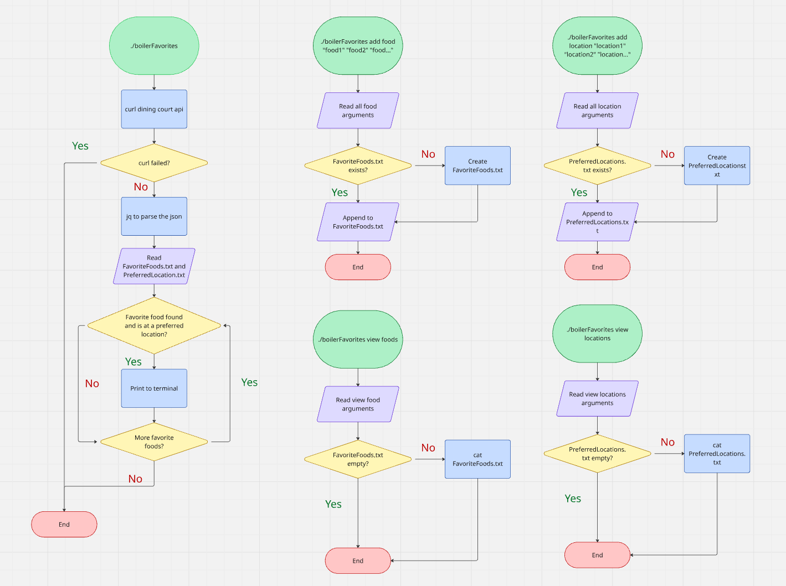

# Boiler Favorites

A bash script that allows you to see if your favorite food(s) is/are available at certain dining courts

## The Problem

Purdue's dining website allows you to see ahead of time what options are given at the dining courts, but it's often tedious to click through each dining court just to find what you're looking for. You already know what foods you want and which dining courts are reasonable for you to go to, so a tool that tells you the what, the when, and the where without having to look yourself would save you a decent amount of time. 

## How It Works

Scrapes Purdue's dining website to retrieve menu options, then checks if the user's favorite food(s) are available at their preferred dining courts that day. If so, the dining court, which station, and which meal time their favorite food(s) is/are offered at is printed to the terminal.



## Tech Stack

- **Language:** Bash
- **External tools:** curl, jq, cat, date, touch, echo, and APIs

## Setup

```bash
this part is work in progress
```

## Usage

Acceptable dining courts to add to the preferred list are Wiley, Winsdor, Ford, Hillenbrand, Earhart, and 1Bowl, each typed exactly as shown.

```bash
./boilerFavorites.sh add food args #Add favorite foods to favoriteFoods.txt
./boilerFavorites.sh add location args #Add preferred dining locations to preferredLocations.txt
./boilerFavorites.sh view foods #Prints favoriteFoods.txt's contents
./boilerFavorites.sh view locations #Prints preferredLocations.txt's contents
./boilerFavorites.sh #Scrapes purdue's dining website and checks if any foods from favoriteFoods.txt are located at locations in preferredLocations.txt, if so, prints relevant information to terminal
```

## Roadmap

- [ ] Terminal notifications whenever user boots up, or at a specified time
- [ ] Filter for allergens
- [ ] Alternative suggestions/locations
- [ ] Help command that lists all available commands, examples, and list of filterable dining locations

## Author

Devran Aydin, [My GitHub](https://github.com/devran-A/)
