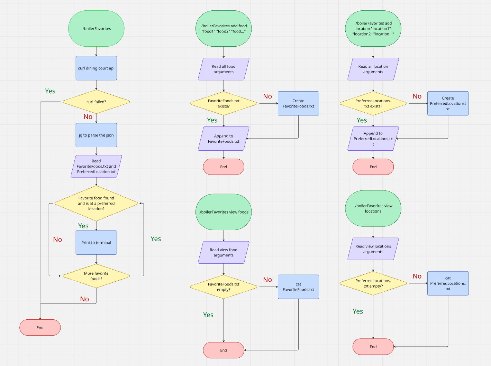

# Boiler Favorites

A bash script that displays if your favorite foods are available at Purdue Dining courts.

## The Problem

Purdue's dining website allows you to see ahead of time what options are given at the dining courts, but it's often tedious to click through each dining court just to find what you're looking for.

## How It Works

Scrapes Purdue's dining website to retrieve menu options, then checks if the user's favorite foods are available at their preferred dining courts. If so, the dining court, which station, and which meal time their favorite food is offered atis printed to the terminal.



## Tech Stack

- **Language:** Bash
- **External tools:** curl, jq, cat, date, touch, echo, grep, sed, mkdir, read, command, ping, chmod, and dining court API

## Setup

```bash
#This script has only been tested on Ubuntu, but it should work for other linux distributions
git clone https://github.com/devran-A/cs193-final-project
cd cs193-final-project
chmod +x install.sh
./install.sh #If you're prompted to install 'jq' then do so with your package manager and rerun the install script
#Feel free to delete the repo after the install script was successful
#If the command doesn't work immediately, you may have to restart your system so .profile can set $PATH to ~/.local/bin
```

**NOTE: IF YOUR PATH VARIABLE ISN'T SET TO ~/.local/bin THEN THE SYSTEM WON'T RECOGNIZE THE BF COMMAND**

## Usage

Acceptable dining courts to add to the preferred list are Wiley, Winsdor, Ford, Hillenbrand, and Earhart, each typed exactly as shown.

```bash
bf add food <item>... #add food items to favorite_foods.txt
bf add location <location>... #add dining locations to preferred_locations.txt
bf view foods #prints favorite_foods.txt's contents
bf view locations #prints preferred_locations.txt's contents
bf #scrapes purdue's dining website and checks if specified favorite foods are located at the specified dining courts
bf run-on-boot {enable|disable} #toggles run on boot functionality
```

**NOTE: WHEN YOU'RE RUNNING A COMMAND THAT TAKES ITEMS, WRAP EACH ITEM IN A STRING, OTHERWISE SPACES IN THE ITEM WILL SEPERATE THE ITEM INTO DIFFERENT PARTS**

```bash
bf add food Cheese Pizza Burger #this will create three food entries, don't do this!
bf add food "Cheese Pizza" "Burger" #this will create two food entries, do this instead!
```

Here is basic example of how you could use this:

```bash
bf add food Rotini "pizza"
```

We added two food entries to favorite_foods.txt, "Rotini" and "pizza."

Notice that pizza is wrapped in quotation marks while Rotini isn't, both forms are acceptable, but it's advised to always wrap items in quotation marks to avoid issues.

Now let's see what our favorite_foods.txt file looks like:

```bash
bf view foods
```

This returns:

```bash
pizza
Rotini
```

Now let's try to run the script!

```bash
bf
```

But we get:

```bash
Favorite food and or preferred location list is empty! Use 'bf add {food|location} <item>,,,' in order to use this command.
```

This is because we haven't specified our preferried dining locations, let's do that now.

```bash
bf add location Wiley
```

Notice how Wiley is capitalized, while when we added pizza to our food list, we didn't have to. This command is case sensitive for locations in order to avoid issues when requesting the specific location's menu, so make sure you are capitalizing the dining location. There is also a list of valid dining locations right beneath the usage header.

Now we can run the bf command.

```bash
bf
```

Now let's assume that both pizza and rotini are available at Wiley today, we should see:

```bash
Pepperoni Pizza | Lunch | Mozzarella Fresca
Pepperoni Pizza | Dinner | Mozzerella Fresca
Rotini | Lunch | Romeo & Parmesan
Rotini | Dinner | Romeo & Parmesan
```

The first thing displayed is the food item that was found, then the meal time, and then the station.

Notice how we requested pizza, but we got pepperoni pizza. When searching for matches, it checks if the favorite food is contained in the string of the food item, in this case "pizza" is contained in the string "Pepperoni Pizza," after you downcase both. If we wanted specifically, say, cheese pizza, we would have to type: 

```bash
bf remove food "pizza"
bf add food "Cheese Pizza"
```

First we removed the old pizza entry, and added a new entry called "Cheese Pizza." If cheese pizza was available at Wiley, then we would see that the next time we run the command.


## Roadmap

- [x] Terminal notifications whenever user boots their system
- [ ] Filter for allergens
- [ ] Alternative suggestions/locations

## Author

Devran Aydin, [My GitHub](https://github.com/devran-A/)
